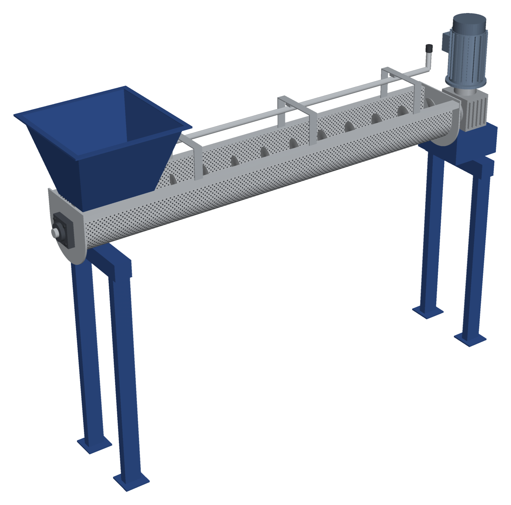
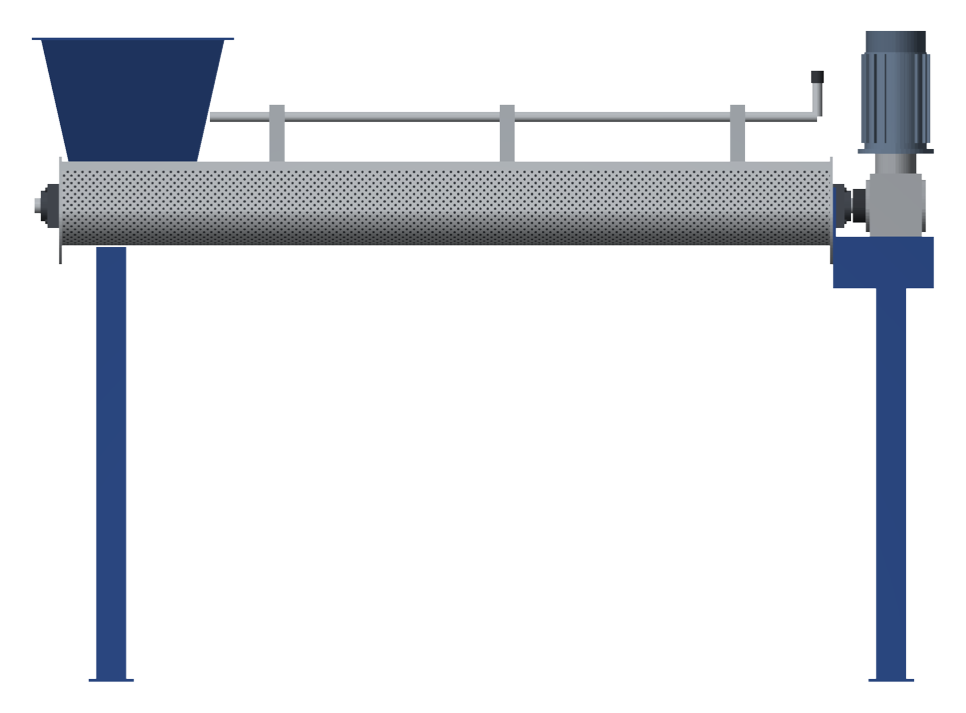
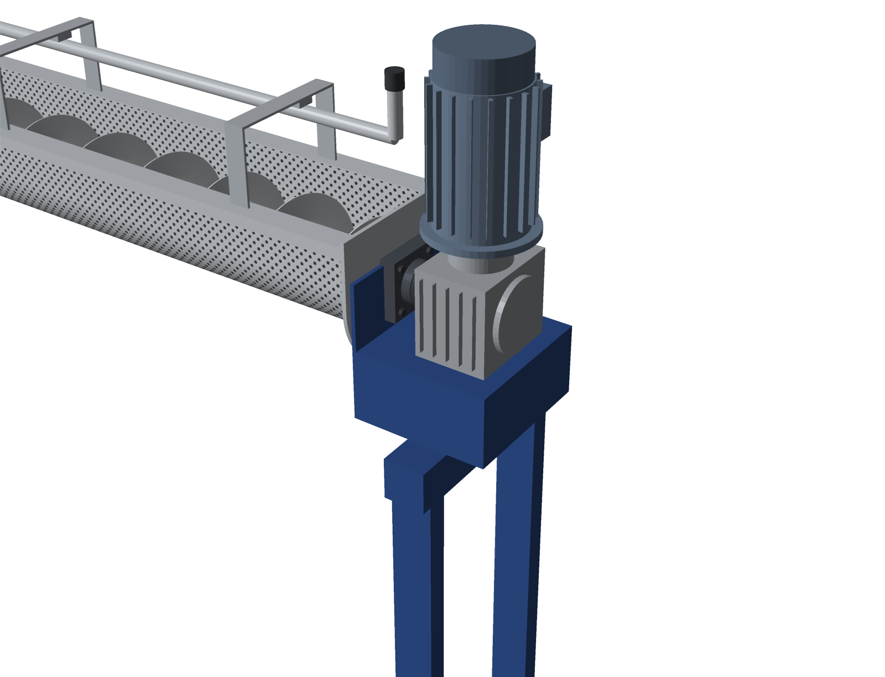
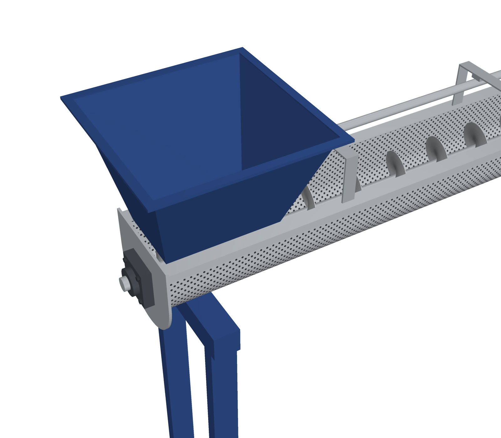

# Screw Conveyor Basah

Konsep 3D screw conveyor untuk material basah, dengan body perforated dan pipa kucuran air. Dibuat oleh **PT Global Inti Sinergi** dan mengacu pada desain *Assy Screw Conv Basah*.

## Simulasi 3D interaktif

[`simulasi/index.html`](simulasi/index.html) adalah simulasi 3D yang berjalan di browser (three.js, tanpa instalasi):

- Push button **ON / OFF** dan lampu status, slider putaran screw 10–90 rpm (nominal 56 rpm)
- Screw berputar, flake masuk dari hopper, terbawa sepanjang body, lalu jatuh ke outlet
- Air kucuran dari pipa 1" menetes menembus lubang perforated Ø8
- Readout kecepatan aksial dan kapasitas volumetrik teoritis
- Opsi body transparan, label, dan 5 sudut pandang (Iso, Depan, Atas, Inlet, Penggerak)

Agar bisa dibuka lewat link, aktifkan **GitHub Pages** (Settings › Pages › Deploy from branch › `main` / root). Simulasi lalu tersedia di `https://<user>.github.io/<repo>/simulasi/`.

## Model 3D

Buka file STL di bawah langsung di GitHub untuk melihat model 3D interaktif (bisa diputar dan di-zoom).

| File | Isi |
|---|---|
| [`model/screw_conveyor_basah_assy.stl`](model/screw_conveyor_basah_assy.stl) | Assembly lengkap |
| [`model/parts/`](model/parts/) | Per sub-assembly: body, screw, motor & gearbox, frame, hopper, pipa, bearing, end plate |

Satuan model adalah milimeter. Lubang perforated tidak dimodelkan di STL supaya file tetap ringan; lubang hanya tampil di gambar render.

## Spesifikasi

| Bagian | Spesifikasi |
|---|---|
| Orientasi | Horizontal |
| Panjang body | 2.500 mm |
| Dimensi total (±) | 2.940 × 660 × 2.120 mm (P × L × T) |
| Body screw | U-trough plat perforated SS304 t3, lubang Ø8, setara 10" (ID ±254), atas terbuka |
| Housing | Rail SS304 t3 di kedua sisi atas body |
| Screw | Flight SS304 t3, OD 240, pitch 200; inti pipa SS304 2" + stub shaft Ø50 |
| Bearing | UCF210 (Ø50), 2 unit |
| Penggerak | Motor 2,2 kW 4P 380 V vertikal + worm gearbox NMRV090 i=25 (±56 rpm) |
| Pencucian | Pipa kucuran 1" SS304 di atas body, 3 dudukan bracket U |
| Plat depan/belakang | SS304 t10 |
| Hopper | Carbon steel, dicat |
| Frame | 4 kaki hollow 100×50 dengan cross beam, base plate, dicat |
| Panel | MCB, kontaktor, thermal overload relay, push button ON/OFF |

## Gambar

| Tampak depan | Detail penggerak | Detail inlet |
|---|---|---|
|  |  |  |

## Catatan

Ini model konsep untuk presentasi dan penawaran. Ukuran detail, posisi outlet material, dan toleransi akhir mengikuti shop drawing yang disetujui.

---

PT Global Inti Sinergi · Gg. Mandor Arimin, Jl. Moh. Sanun No.47, Harapan Jaya, Cibinong, Kab. Bogor, Jawa Barat 16914
